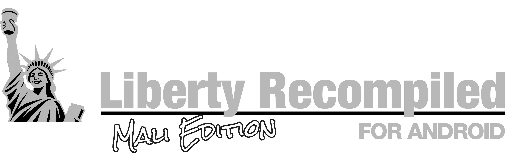

    

# LibertyRecompAndroid — Mali Edition (Alpha)

> [!WARNING]
> **Alpha, work in progress.** This is a fork of
> [LibertyRecompAndroid](https://github.com/vaduur/LibertyRecompAndroid) that runs the game on
> **ARM Mali GPUs** (MediaTek Dimensity, Google Tensor, Samsung Exynos with Mali). Expect bugs and
> rough edges. If you have a Snapdragon (Adreno) phone, use the original project.

An Android port of [Liberty Recompiled](https://github.com/OZORDI/LibertyRecomp), the static
recompilation of the Xbox 360 version of Grand Theft Auto IV. The game runs **natively** on arm64
Android; there is no emulator in between. This fork uses the phone's own Mali Vulkan driver.

**Latest version: 0.5.9-mali-alpha-1.4** (based on upstream 0.5.9). Download it from
[Releases](../../releases).

> [!IMPORTANT]
> **Updating from alpha 1.3 or older:** uninstall the old version once before installing 1.4
> (back up `Android/data/com.libertyrecomp/` first if you want to keep your installed game). From
> 1.4 on, every build uses the same signing key, so later updates install normally.

## Supported GPUs

| GPU | Example phones | Status |
|---|---|---|
| Mali-G720 / Immortalis-G720 | Dimensity 8400 | ✅ Tested, playable |
| Mali-G615, Mali-G710 / G715 | Dimensity 8300, Google Pixel (Tensor) | 🟡 Should work since alpha 1.4 (untested) |
| **Mali-G68** and other GPUs without `shaderInt64` | Galaxy A35 / A55, Dimensity 900 / 1080, Exynos 1280 / 1380 | ❌ Not supported |

Requirements: arm64, Android 10+, Vulkan 1.2 with `shaderInt64` (check in *Vulkan Caps Viewer →
Features → Core 1.0*), about 15 GB free during install.

## What's in the Mali Edition

### Liberty touch controls
- **Icon buttons that follow what you are doing:** on foot, driving, phone, pause menu, and
  cutscenes (with a **Skip** button). Hidden on loading screens.
- **Customisable:** hold **Pause** for 1.5 s to edit. **Drag** a button to move it, **pinch** with
  two fingers to resize it, **Reset** restores the screen's default layout, tap **Pause** to save.
- **Switch any time:** the gamepad icon at the top switches to a classic **Xbox controller**; its
  **LIBERTY** button switches back.

### Launcher
- **Graphics & controls:** resolution, FSR 1, anti-aliasing, frame limit, draw distance,
  population density, shadows, motion blur, run-ahead frames, touch controls, button size,
  opacity and labels, and **CPU boost**. *Default* keeps your `args.txt` value; press
  **Save changes**, then **Play**.
- **Performance overlay:** a small corner box with the game's **real** FPS, frame time, CPU usage
  and clock, memory, and more (each line can be turned on or off).

### Performance
- **CPU boost:** the game tells Android how fast its frames need to be (Performance Hint API) for
  all of its busy threads, so the phone keeps them on fast clocks. *Steady* is the default;
  *Maximum* boosts harder (warmer), *Battery* saves power.
- **Multi-core texture loading** for smoother driving into new areas.
- Upstream 0.5.9's optimised recompiled code and renderer.

### Mali compatibility fixes
- **No BC (DXT) texture support on Mali:** textures are decoded on load, so the world renders.
- **No clip distances on Mali:** shaders are adjusted on load (some reflections may look off).
- **No 2× MSAA on some Mali GPUs** (G615, G710/G715): 4× is used instead, fixing a black world.
- Android C++ library gaps (`jthread`, `atomic_ref`, floating-point `from_chars`) filled in.
- The **Emulated** renderer is hidden on Android; the launcher always starts the Vulkan renderer
  (choosing Emulated used to crash every launch).

## Tips for better performance

The game is limited by its **CPU work**, not the GPU, so:
- Lower **Population density** and **Draw distance** in the launcher; resolution and FSR help little.
- Keep the phone cool. Use your phone's **game mode** (for example Xiaomi Game Turbo →
  performance) and avoid playing while charging.
- About **20–30 FPS** in the city and 30 FPS indoors on the Dimensity 8400.
- Use PanVK drivers by [FristOneRR.](https://github.com/FristOneRR/FristOneRR-Panvk-Driver/releases/latest)

## Known issues
- Performance drops in busy city areas; clocks still vary with heat.
- Some reflections or cut-off geometry may look wrong (no clip distances on Mali).
- Higher memory use than on Adreno (decoded textures).
- Occasional crashes may still happen. **Save often.**

## Reporting problems

Open an [Issue](../../issues) and attach `Android/data/com.libertyrecomp/files/last_launch.txt`
and, if the game starts, a log from **Play (Debug Log)** (`files/debug_logs/`). Please mention your
phone model and GPU.

Mali Support and Extraz by [prollynotzjay](https://github.com/prollynotzjay/LibertyRecompAndroidMaliVer).

---

The rest of this README is from the original project and describes the Adreno build.

**DISCLAIMER!**

This is pure 100% AI slop. I didn't made this by hand at all, it's all thanks to Claude and I, vaduur, take ZERO credit or responsibility of this port being unstable. It will run shitty, that's a guarantee. All I did is spent couple of sleepless night testing and pointing out the issues. Oh, yeah, and spent some pocket change on Claude sub ofc. Please be aware of it and feel free to fork this repo or use it as a reference in your future ReXGlue to Android ports. Thank you and have a nice day.

BTW, Any feedback is very appreciated, [Issues](https://github.com/vaduur/LibertyRecompAndroid/issues) are open, submit a ticket if you have any.

> [!CAUTION]
> This is an experimental, unofficial port of a project that is itself in early development.
> Expect crashes and rough edges. It has been developed and tested on **one device**, a
> Retroid Pocket 5 (Snapdragon 865 / Adreno 650).

> [!NOTE]
> New features land in **[pre-releases](https://github.com/vaduur/LibertyRecompAndroid/releases)**
> first, while they are being tested. The release marked *Latest* is the stable one. Pre-releases
> are listed above it and marked *Pre-release*. Feedback on them is welcome in
> [Issues](https://github.com/vaduur/LibertyRecompAndroid/issues).

**This project does not include any game assets.** You need your own legally obtained copy of the
Xbox 360 game and its title update. Nothing here helps you get them.

## Status

On the Retroid Pocket 5 with the default settings:

- The game installs, boots and plays: the intro, the early story missions, free roam and driving
  have been played. Saves persist across launches.
- The game renders at the console's native 720p with FXAA. The display scales the image to the panel.
- Frame rate is capped at 30 FPS with VSync. Most places hold a steady 30. The heaviest far views
  (bridges, the skyline at night) drop to about 25–29 FPS.
- Shadows, draw distance and the shadow map size match the console. Traffic and pedestrian density
  are reduced to 40% of the PC defaults to save CPU time.
- Audio works, including the radio, cutscenes and Bink videos.

Known problems:

- Occasional crashes to the home screen still happen. Save often.
- The in-game installer's **Select File / Select Folder** buttons do not work on Android. Install
  from the launcher (0.5.7+) or through the app's `install` folder instead (see
  [INSTALL.md](docs/android/INSTALL.md)).
- One deferred light-volume shader is skipped, because it hangs the GPU under Turnip. A few
  light volumes are missing as a result.
- The episodes (The Lost and Damned, The Ballad of Gay Tony) and online multiplayer have not been
  tested on Android.
- The on-screen gamepad is new (0.5.7.2) and has only been tried on the Retroid Pocket 5 so far
  (see [Controls](#controls)).

## Device requirements

| | Requirement |
|---|---|
| **GPU** | **Qualcomm Adreno 6xx or 7xx** (Snapdragon). Developed and tested on the Adreno 650. **Adreno 8xx: experimental since 0.5.7.5**, see below. |
| **SoC** | Snapdragon 865 class or faster recommended (SD 865/870/888, 8 Gen 1/2/3, 8s Gen 3, …). |
| **CPU** | arm64 with ARMv8.2-A (the build uses LSE atomics). ARMv8.0 chips such as the Snapdragon 835 crash on start. |
| **Android** | Android 10 (API 29) or newer, 64-bit. |
| **RAM** | 8 GB recommended. 6 GB is untested. |
| **Storage** | About 7 GB for the installed game, plus room for the disc image while installing (about 15 GB free in total). |
| **Controller** | An XInput (Xbox-layout) gamepad is strongly recommended, see [Controls](#controls). |

**Not supported:**

- **ARM Mali / Immortalis GPUs** in the normal build. This covers most Exynos chips before the
  2200, MediaTek Dimensity/Helio and Google Tensor. An **untested** Mali build that uses the
  phone's own Vulkan driver is described in [MALI.md](docs/android/MALI.md) (aimed at the
  Dimensity 8400).
- **Samsung Xclipse GPUs** (Exynos 2200 and newer).
- **PowerVR GPUs** and anything else that is not an Adreno.

Why only Adreno: the renderer needs Vulkan 1.2 and was tuned on Turnip. Turnip is Mesa's open-source
Vulkan driver, and it exists only for Adreno GPUs. The stock Qualcomm driver on older devices
(including the Adreno 650) exposes only Vulkan 1.1. On other GPUs the bundled driver cannot load,
and nobody has run the renderer on their vendor drivers.

**Adreno 8xx (Snapdragon 8 Elite and newer): experimental, since 0.5.7.5.** The game has been
started on an Adreno 840 (Samsung, Android 17). The bundled Turnip build does not support Adreno
8xx, so import a Turnip build for it on the launcher (**Import driver (.zip)**), such as the Gen8
Turnip builds made for emulators. This is how it was tested. Expect rough edges, and please report
how it runs in [Issues](https://github.com/vaduur/LibertyRecompAndroid/issues). Low-end Adreno
6xx parts (610/618/619) should start, but expect them to be far too slow.

Since 0.5.6.2, when the bundled Turnip cannot drive the GPU, the app falls back to the device's own
Vulkan driver if that driver offers Vulkan 1.2. This is untested on any GPU. If no usable driver
exists, the app shows a dialog with the reason instead of closing silently, and it writes
`Android/data/com.libertyrecomp/files/last_launch.txt` with the device, GPU and driver details.
Attach that file when you report a problem.

## Controls

**An XInput (Xbox-layout) gamepad is strongly recommended.** For example:

- an Xbox controller over Bluetooth or USB;
- any XInput-compatible pad;
- the built-in controls of a gaming handheld (Retroid, AYN Odin, AYANEO and similar) in Xbox
  mode.

The game is the Xbox 360 version, so its controls and button prompts follow the Xbox layout one to
one. Other controllers that Android recognizes (DualShock, DualSense, Switch Pro and so on) usually
work through SDL. Their buttons are mapped by position, though, and they have seen much less
testing.

**On-screen gamepad (0.5.7.2 and newer).** Without a controller, the game shows a translucent
Xbox 360 controller on the screen. It disappears as soon as a gamepad is connected, and comes back
when it is disconnected.

- **Left stick:** touch anywhere on the left half of the screen (outside the buttons). The stick
  centres where your thumb lands.
- **Right stick (camera):** touch anywhere on the right half of the screen. It works like a
  controller's right stick.
- **Buttons:** A/B/X/Y lower right, D-pad next to the left stick, LT/LB above the left stick, RT/RB
  on the right, L3/R3 next to the bumpers, Back/Start at the top. Several fingers work at once.
- **Menus** are driven with the same buttons, as on a controller.

Settings in `args.txt` (see [ADVANCED.md](docs/android/ADVANCED.md#other-useful-settings)):

- `--touch_controls=auto|on|off`. `auto` shows the overlay whenever no gamepad is connected, `on`
  always shows it, `off` never does.
- `--gta4_touch_layout=context` brings back upstream's context-sensitive touch layout instead of
  the gamepad.

## Game files required

- The **Xbox 360 GTA IV disc** as an `.iso` image. Only the **USA (NTSC-U)** release has been
  verified.
- **Title Update 8** for that release (version **0.0.8.5**), either as the STFS package or as a raw
  `default.xexp`. The PAL title update (0.0.8.6) is rejected.

The port was developed and tested with these exact files:

| File | Size | MD5 | SHA-1 |
|---|---|---|---|
| `Grand Theft Auto IV (USA) (En,Fr,De,Es,It).iso` (full disc image) | 7,835,492,352 bytes | `f0a046aed1520a913b2125f0a69ee7d0` | `caa48dfb3b1b2fe3131e61fc66e35a22c6d0ba13` |
| `TU_1A581VI_000000K000000.0000000000205` (Title Update 8, STFS package) | 3,715,072 bytes | `f041b5f6721d7ee578560bac21668826` | `88d1c438814298b6da987b3ad5edc7e48a769ac9` |

If your files match, they are known to work. Other dumps of the same USA disc (for example
trimmed or extracted images) may work too, but they have not been tested. Check your files with
`certutil -hashfile <file> MD5` on Windows, or `md5sum <file>` on Linux and macOS.

See the upstream [dumping guide](docs/DUMPING-en.md) for how to get these files from your own
console and disc.

## Quick start

1. Install `LibertyRecompAndroid-*.apk` from the [Releases](../../releases) page and open it. The
   app opens on a launcher with the game status, the installer, the Vulkan driver choice and
   **Play** (see [INSTALL.md](docs/android/INSTALL.md#2-open-the-app-the-launcher)).
2. In the **Game** panel (0.5.7 and newer), choose your disc image (`*.iso`) and the Title Update 8
   file wherever they are on the device. The app asks once for *All files access*. On older
   versions, or without that permission, copy both into
   `Android/data/com.libertyrecomp/files/install/` instead (a PC over USB is the easiest way).
   The tested files ([details](#game-files-required)):
   - disc: `Grand Theft Auto IV (USA) (En,Fr,De,Es,It).iso`, MD5 `f0a046aed1520a913b2125f0a69ee7d0`
   - TU8: `TU_1A581VI_000000K000000.0000000000205`, MD5 `f041b5f6721d7ee578560bac21668826`

   The file names do not matter, as long as the disc image ends in `.iso`.
3. Press **Install**, wait for it to finish, then press **Play**.

The full walkthrough, including the `install/` folder and older versions, is in
[INSTALL.md](docs/android/INSTALL.md).

## Documentation

| Document | Contents |
|---|---|
| [Installation and first launch](docs/android/INSTALL.md) | Installing the APK, copying the game files, the first-run installer, upgrading |
| [Advanced configuration](docs/android/ADVANCED.md) | `args.txt` settings, live tuning, driver selection, logs, performance presets |
| [What was done for Android](docs/android/PORTING.md) | Technical write-up of the port: build, platform layer, driver, renderer and stability work |
| [Building from source](docs/android/BUILDING.md) | Building the APK yourself |
| [Mali build](docs/android/MALI.md) | The untested variant for Mali / Immortalis GPUs (Dimensity 8400) |
| [Upstream README](README_UPSTREAM.md) | The original Liberty Recompiled README (desktop builds, mods, online) |

## Credits

- [Liberty Recompiled](https://github.com/OZORDI/LibertyRecomp) by OZORDI and contributors, and the
  [ReXGlue SDK](https://github.com/rexglue/rexglue-sdk) it is built on. Almost all of the hard work
  of recompiling GTA IV is theirs. This fork adds the Android platform layer and the Android
  performance work.
- [Mesa Turnip](https://docs.mesa3d.org/drivers/freedreno.html), the open-source Adreno Vulkan driver.
  The bundled build is StevenMXZ's Turnip 26.3.0-R6.
- [libadrenotools](https://github.com/bylaws/libadrenotools) by bylaws, which loads a custom driver
  into an app.
- The Vulkan driver proxy comes from [skate3-android](https://github.com/andrewnakas/skate3-android)
  and [skate3-pocket](https://github.com/AlanConstantino/skate3-pocket).
- [SDL3](https://github.com/libsdl-org/SDL) for the Android activity, input and audio.
- [nfsmw-nx](https://github.com/StevensND/nfsmw-nx) by StevensND, a ReXGlue port of Need for Speed:
  Most Wanted to the Nintendo Switch and a great reference for running a ReXGlue recompilation on
  weak hardware. Our direct-calls tool (`gta4-recomp/tools/direct_calls.py`) is adapted from their
  `llamadas_directas.py`. Their work on game busy-waits and thread placement led to this port's
  frame-wait hook and thread pinning experiments.

Grand Theft Auto IV is a trademark of Take-Two Interactive Software. This project is not affiliated
with or endorsed by Rockstar Games or Take-Two Interactive.
